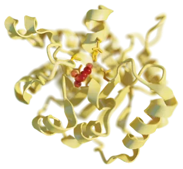
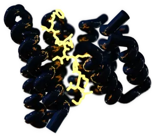
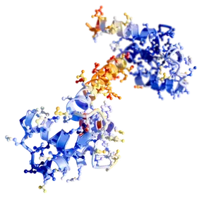
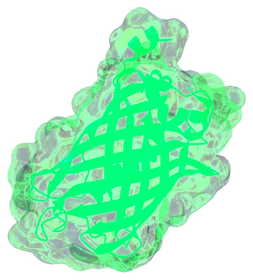
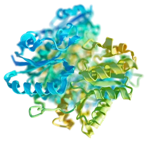
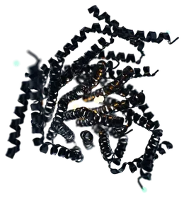
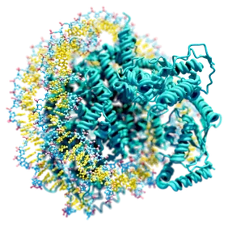
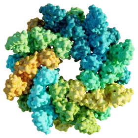
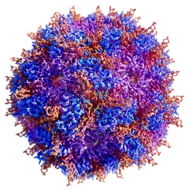
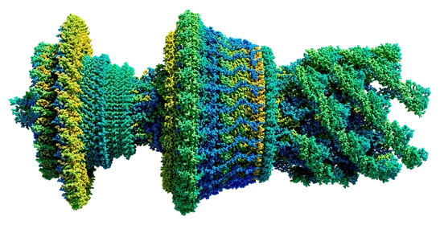

#  FoldRay

**Stunning protein visualisations made easy, in your browser.**

Use it at **[www.foldray.org](https://www.foldray.org)** or [download it here](#install).

FoldRay is a browser-based app that aims to make beautiful protein structure visualisation quick and
easy. Load a structure, pick a style, and download a ray-traced render in seconds. Detailed
customisation options also let you make every picture your own.

Ray tracing follows light as it bounces around the molecule. It takes a little time and computing
power, but the result has real shadows, soft light, and realistic materials such as glass and metal,
which makes an enormous difference to the quality of a visualisation.

Everything happens in your browser, on your computer. Your structures are never uploaded, so they
stay private.

The [guide](https://www.foldray.org/home/#guide) covers everything, from loading a structure to the
final picture.

## Examples

<p>
<a href="https://www.foldray.org/home/#gallery"></a>
<a href="https://www.foldray.org/home/#gallery"></a>
<a href="https://www.foldray.org/home/#gallery"></a>
<a href="https://www.foldray.org/home/#gallery"></a>
<a href="https://www.foldray.org/home/#gallery"></a>
<a href="https://www.foldray.org/home/#gallery"></a>
<a href="https://www.foldray.org/home/#gallery"></a>
<a href="https://www.foldray.org/home/#gallery"></a>
<a href="https://www.foldray.org/home/#gallery"></a>
<a href="https://www.foldray.org/home/#gallery"></a>
<a href="https://www.foldray.org/home/#gallery"></a>
<a href="https://www.foldray.org/home/#gallery"></a>
<a href="https://www.foldray.org/home/#gallery"></a>
</p>

Rendered in FoldRay. The structures are credited in `docs/attributions.md`.

## What you need

- A desktop browser with WebGPU: Chrome or Edge 113+, Safari 26+ on macOS 26, or Firefox 141+ (147+
  on an Apple-silicon Mac).
- A screen at least 1124 × 520 pixels.
- A graphics card. Most should work, but rendering speed depends on the card.

FoldRay is in beta (version 0.1.0), so expect the odd rough edge.

## Install

Needs [Git](https://git-scm.com) and [Node.js](https://nodejs.org) 20.19+ or 22.12+, which comes with
npm.

```bash
git clone https://github.com/stetinam/foldray.git && cd foldray && npm install && npm run dev
```

Then open <http://localhost:5173>.

## Citing FoldRay

If you used [FoldRay](https://www.foldray.org) for your protein visualisation, consider citing:

```text
Stetina, M. (2026). FoldRay (beta 0.1.0) [Computer software]. https://www.foldray.org
```

## Disclaimer

FoldRay is in beta (version 0.1.0), so there may be bugs.

FoldRay and the pictures it makes are illustrative and not for clinical use.

FoldRay was developed with Claude Code, mainly with Claude Opus 5.0 and Opus 5.5 (1M context) at
medium to extra-high effort.

It is provided as is, without warranty of any kind, under the MIT licence.

## Licence & attributions

FoldRay is open source under the MIT licence, © 2026 Max Stetina (`LICENSE`). The licence covers
FoldRay's own source. It does not extend to the third-party work FoldRay is built on, which is
credited in `docs/attributions.md` and on the website's
[Licence & Attributions](https://www.foldray.org/home/#licence) page. Some files here are that work:
the environment maps in `public/assets/env/` (CC0), the Filmic tables in `public/assets/luts/` (Troy
Sobotka), and a few shader functions adapted from Cycles, three.js and Filament, noted in their
comments.

The FoldRay logo and the example pictures in `docs/examples/` are not covered by the MIT licence,
© 2026 Max Stetina.

FoldRay was inspired by the stunning protein visualisations that Blender and Cycles can produce,
particularly with representations from Molecular Nodes (a Blender addon by Brady Johnston) or PyMOL.
These workflows need a desktop Blender setup and some expertise; FoldRay aims to make high-quality
protein images quick, simple and available to anyone with a browser.
